# Team 2B — Clinical NLP & Safety Logic: Project Documentation

**Project:** Privacy-Preserving Clinical Scribe and Diagnostic Copilot (Problem Statement 2)
**Module:** Team 2B — transcript → structured, safety-checked, grounded clinical documentation
**Version:** pipeline 1.0.0 · rules 1.0.0 · JSON schema 1.0
**Status:** working prototype. It runs fully offline and is integrated with Team 2A's transcript format and endpoint, and it exposes the JSON contract agreed with Team 2C.

> ⚠️ **Not for clinical use.** This is an academic prototype. All drug knowledge is a curated teaching subset and must be reviewed by a clinician. Every generated note is a *draft* that requires physician sign-off.

---

## Contents

1. [What Team 2B does](#1-what-team-2b-does)
2. [Architecture](#2-architecture)
3. [Feature list](#3-feature-list)
4. [Integration contracts (Team A in, Team C out)](#4-integration-contracts)
5. [Pipeline stages in detail](#5-pipeline-stages-in-detail)
6. [Safety rule catalogue](#6-safety-rule-catalogue)
7. [Grounding, hallucination scoring and confidence](#7-grounding-hallucination-scoring-and-confidence)
8. [Privacy and security design](#8-privacy-and-security-design)
9. [Configuration](#9-configuration)
10. [Running the project](#10-running-the-project)
11. [Testing and evaluation](#11-testing-and-evaluation)
12. [Project structure](#12-project-structure)
13. [Limitations and roadmap](#13-limitations-and-roadmap)
14. [What changed from the original prototype](#14-what-changed-from-the-original-prototype)

---

## 1. What Team 2B does

The scribe is built by three teams:

| Team | Responsibility | Interface with Team B |
|---|---|---|
| **2A** On-device audio & transcription | Recording, local Whisper ASR, diarization, DOCTOR/PATIENT labelling | Sends a speaker-labelled, timestamped JSON transcript (`GET /api/v1/live/team-b/consultation/{id}`) |
| **2B** Clinical NLP & safety logic (this repo) | Entity extraction, deterministic conflict detection, SOAP note and draft prescriptions, claim-level grounding | Consumes 2A's transcript and exposes structured JSON to 2C |
| **2C** EHR interface & validation dashboard | Physician review/edit/sign-off, PDF/FHIR export, hallucination score display | Pulls Team B's JSON (`GET /v1/consultations/{id}`) |

The problem statement names two core risks:
- **Hallucination.** The LLM might write a symptom or diagnosis that was never said.
- **Missed safety conflicts.** Examples are a male patient documented as pregnant, or penicillin prescribed to a patient who said they are allergic to it.

Team B's design answers both with two principles:

1. **Deterministic first.** Facts, safety decisions, citations and timestamps are produced by auditable Python code. The LLM is optional: it can *add* evidence-verified facts and write more fluent prose, but it never decides safety and never invents provenance.
2. **Verify everything.** Every sentence in the note is a *claim*. It cites transcript segments and is independently checked against the transcript before Team C sees it.

---

## 2. Architecture

```mermaid
flowchart LR
    A[Team 2A<br/>Whisper + diarization] -->|JSON transcript| I[Ingestion & validation<br/>segment ids + SHA-256]
    I --> P[PHI pseudonymisation<br/>only for LLM calls]
    I --> R[Rule-based extractor<br/>negation, family, history,<br/>Q&A inference, dosing]
    P --> L[LLM extractor<br/>Qwen3-8B via Ollama<br/>quote-verified]
    R --> M[Hybrid merge<br/>rules win on disagreement]
    L --> M
    M --> S[Deterministic safety engine<br/>11 rules, fail-closed]
    S --> RX[Draft prescriptions]
    S --> G[SOAP generation<br/>template or LLM]
    G --> SC[Blocked-item scrub<br/>+ omission backfill<br/>+ safety notices]
    SC --> V[Claim-level grounding verifier]
    V --> O[Status + confidence<br/>Team C JSON]
    O --> DB[(SQLite store)]
    DB -->|GET /v1/consultations/id| C[Team 2C dashboard]
```



**Request flow.** Team A pushes a transcript (`POST /v1/analyze`), or Team B pulls one from Team A (`POST /v1/team-a/consultations/{id}/analyze`). The result is stored and served to Team C. The deterministic path takes about 1–5 ms per consultation. The LLM path takes about 1 minute on a laptop (Qwen3-8B, Apple Silicon).

**Operating modes**

| Stage | Mode | Behaviour |
|---|---|---|
| Extraction | `rule` | Deterministic only (instant, offline) |
| | `hybrid` | Rules plus LLM entities that pass evidence verification |
| | `llm` | Verified LLM entities only (for ablation) |
| | `auto` (default) | `hybrid` if the local LLM is reachable, otherwise `rule` |
| Generation | `template` | Deterministic SOAP; cannot introduce new facts |
| | `llm` | LLM prose, then scrub, backfill and verification |
| | `auto` (default) | `llm` if reachable, otherwise `template` |

If Ollama is down, the pipeline **never fails**. It degrades to the deterministic path and records a warning in `metadata.warnings`.

---

## 3. Feature list

### Integration
- Accepts **Team A's agreed JSON format** (`consultation_id`, `segments[speaker, start_time, end_time, text, confidence]`). It also accepts the legacy turn format and tolerates a `{"data": {...}}` envelope.
- **Pull integration** with Team A's endpoint `GET /api/v1/live/team-b/consultation/{id}` (configurable base URL, timeouts, and errors mapped to 404/502).
- **Team C contract.** It keeps every field already promised (`patient_info`, `soap_note` strings, `conflicts[type, allergy, medication, severity, status, message]`, `safety_status`) and adds confidence scores (requested by Team C), claim citations with audio timestamps, draft prescriptions and grounding metrics.
- **Result store** (SQLite) with revision numbers, so Team C can pull by consultation id. CORS is enabled for a local dashboard.
- OpenAPI docs at `/docs`, plus health and version endpoints.

### Clinical NLP
- Rule-based extractor for 8 entity types: symptom, finding, allergy, medication, vital, diagnosis, procedure, demographic.
- 10 assertion statuses: PRESENT, ABSENT, POSSIBLE, HISTORICAL, CURRENT, STOPPED, RECOMMENDED, PRESCRIBED, FAMILY_MEMBER, UNKNOWN.
- **NegEx-style context engine.** It handles negation with clause scope ("No cough or shortness of breath, *just* body aches"), pseudo-negations ("not sure", "didn't help"), family attribution, history and resolution ("gone now"), and uncertainty.
- **Medication intent:** prescribed, recommended, current, stopped, historical, or avoided. "Avoid amoxicillin and use azithromycin" and "instead of amoxicillin…" are handled correctly.
- **Allergy understanding:**
  - allergens are never mistaken for prescriptions;
  - class allergens ("sulfa drugs", "NSAIDs") and non-drug allergens (peanuts, latex) are recognised;
  - reaction capture ("hives last time I took it");
  - "drug gives me hives" phrasing;
  - NKDA.
- **Dialogue inference.** Doctor questions are never treated as facts. The patient's yes/no answer resolves them ("Any fever?" → "No." gives fever ABSENT). An allergy answer without the word "allergic" also works ("Any allergies?" → "Penicillin.").
- **Dosing:** dose (mg normalised), frequency (doses/day), route and duration.
- **Vitals:** temperature (°F/°C inferred), blood pressure, heart rate, respiratory rate, SpO₂ and weight.
- **Demographics:** age and sex, from explicit statements or (at lower confidence) from forms of address such as "Mr."; pregnancy, including gestational weeks.
- **Vocabulary:** brand names map to generics (Advil → ibuprofen, Bactrim → sulfamethoxazole-trimethoprim). There are 98 drugs, 41 symptoms, 43 diagnoses, 29 procedures and 10 exam findings, each with spoken synonyms.
- **Verified LLM extraction (optional).** The model must cite a segment id plus a verbatim quote. Entities are rejected if the quote isn't in the segment, the quote comes from a question, or (for diagnoses) the term was never spoken.

### Safety (deterministic, fail-closed)
- 11 rules (see [§6](#6-safety-rule-catalogue)): allergy and drug class, cross-reactivity, drug-drug interactions, duplicate therapy, dose range, sex-specific conditions and procedures, pregnancy, age, vital signs, inconsistent history, and transcription quality.
- There are two levels of action:
  - **BLOCKED.** The item is removed from the note and its draft prescription is blocked.
  - **REVIEW_REQUIRED.** The physician must look at it before sign-off.
- The engine **blocks only when the evidence is strong**. For example, sex inferred only from "Mr." leads to review, not a block, and an existing regimen is reviewed rather than blocked.
- A crashing rule produces a REVIEW_REQUIRED conflict, never a silent pass.
- Every conflict carries evidence quotes with timestamps, a recommendation and a confidence.

### Documentation generation
- SOAP note in two forms: per-claim structure (`soap_claims`) and plain section strings (`soap_note`).
- The **template generator** is deterministic and grounded by construction. It writes pertinent negatives, family history, allergies with reactions, and explicit "no diagnosis stated" statements instead of inventing one.
- The **LLM generator** sees only non-blocked, verified facts. Its output then goes through:
  - a **blocked-item scrub**;
  - an **omission backfill**, which re-adds any verified fact the LLM dropped;
  - **safety notices injected by code**, never by the LLM.
- **Draft prescriptions** carry DRAFT / NEEDS_REVIEW / BLOCKED status, missing-field detection and a signature requirement.

### Grounding and hallucination scoring
- Claim-level verification:
  - citation validity;
  - **hallucinated clinical terms**;
  - **polarity contradictions** (denied, family member, or blocked);
  - **numbers missing from the cited segments**;
  - lexical support.
- Report metrics: grounding score, hallucination score, unsupported and contradiction rates, citation-verification rate, and entity coverage (completeness).
- **Provenance hashes.** Every segment has a SHA-256 hash and every citation carries it, so anyone can re-hash Team A's transcript and verify a citation.

### Privacy
- Local-first: the default model runs on-device through Ollama.
- **Remote LLM endpoints are refused** unless `ALLOW_REMOTE_LLM=true`.
- **PHI pseudonymisation** before every LLM call: names, phones, emails, IDs (Aadhaar or SSN style), dates and addresses.
- Prompts, completions and transcript text are never logged. Errors return an error id only.

### Tooling
- **Streamlit developer console** (`streamlit_app.py`). It loads samples, uploads or pastes JSON, fetches from Team A, switches modes, and inspects the note, conflicts, prescriptions, entities, transcript and the Team C JSON.
- **Evaluation harness:** labelled cases, hallucination injection, and a safety ablation that generates the markdown and JSON report.
- **Test suite:** 117 tests covering unit, API integration and an evaluation regression gate. All run offline in under 1 second.
- Docker image (non-root, health check, PHI on a volume) and docker-compose.
- MTS-Dialog converter for building a held-out dataset.

---

## 4. Integration contracts

### 4.1 Input from Team A

Agreed by email (Sep 5 – Oct 31, 2026). Team A exposes `GET /api/v1/live/team-b/consultation/{consultation_id}`.

```json
{
  "consultation_id": "20261031_143022",
  "segments": [
    {"speaker": "DOCTOR",  "start_time": 0.0,  "end_time": 3.45, "text": "Good afternoon, Mr. Davis. What brings you into the clinic today?", "confidence": 0.98},
    {"speaker": "PATIENT", "start_time": 3.82, "end_time": 9.15, "text": "Hi Doctor, I've had a severe sore throat and a low-grade fever for the past three days.", "confidence": 0.96}
  ]
}
```

| Field | Required | Notes |
|---|---|---|
| `consultation_id` | yes | `[A-Za-z0-9_.:-]{1,128}` |
| `segments[].speaker` | yes | `DOCTOR` / `PATIENT` (also `NURSE`). Anything else (`SPEAKER_1`) becomes `UNKNOWN` and is flagged for review. |
| `segments[].start_time`, `end_time` | yes | Seconds, with `end_time >= start_time` |
| `segments[].text` | yes | Empty segments are dropped |
| `segments[].confidence` | optional | ASR confidence 0–1. It scales entity confidence; values below 0.60 on safety-critical text are flagged. |

Segments are sorted by time and given stable ids `S001…`, plus a SHA-256 hash of `consultation_id|index|speaker|start|end|text`.

### 4.2 Team B API

Base URL: `http://localhost:8001`. Interactive docs are at `/docs`.

| Method & path | Consumer | Purpose |
|---|---|---|
| `POST /v1/analyze` | Team A / tools | Analyse a pushed transcript. Optional query: `extraction_mode`, `generation_mode`. |
| `POST /v1/team-a/consultations/{id}/analyze` | Team B / ops | Pull the transcript from Team A, then analyse it |
| `GET /v1/consultations/{id}` | **Team C** | Latest analysis for a consultation |
| `GET /v1/consultations?limit=50` | **Team C** | Recent analyses (id, status, conflict count, revision) |
| `GET /v1/health` | ops | Service, LLM and store status |
| `GET /v1/version` | ops | Pipeline, rule and schema versions |

Errors:
- `422`: invalid transcript.
- `404`: unknown consultation, or Team A has no transcript.
- `502`: Team A unreachable.
- `503`: an LLM mode was explicitly requested but the LLM is unavailable.
- `500`: the response carries an `error_id` only and contains no PHI.

### 4.3 Output to Team C

This is a superset of the sample sent to Team C on Sep 15, with the confidence scores Team C asked for on Sep 18. Full examples: [`docs/samples/team_c_response_conflict.json`](samples/team_c_response_conflict.json) and [`docs/samples/team_c_response_20261031_143022.json`](samples/team_c_response_20261031_143022.json).

```json
{
  "schema_version": "1.0",
  "consultation_id": "demo_conflict_001",
  "generated_at": "2026-11-03T05:03:05Z",
  "safety_status": "CONFLICT_DETECTED",
  "requires_physician_signoff": true,
  "patient_info": {
    "demographics": {"sex": null, "age": null, "pregnancy_status": null},
    "allergies": ["Penicillin"],
    "medications": []
  },
  "soap_note": {
    "subjective": "Patient reports sore throat and fever for three days. Allergies: penicillin (reaction: hives).",
    "objective": "Temperature 101.2 °F. Examination: pharyngeal erythema.",
    "assessment": "No diagnosis was stated during the consultation; assessment deferred to the reviewing physician.",
    "plan": "SAFETY BLOCK: Amoxicillin conflicts with documented penicillin allergy (penicillin-class antibiotics). Excluded from this draft; physician review required."
  },
  "conflicts": [{
    "conflict_id": "K001", "rule_id": "ALLERGY_MEDICATION", "type": "MEDICATION_ALLERGY",
    "allergy": "Penicillin", "medication": "Amoxicillin", "severity": "HIGH", "status": "BLOCKED",
    "message": "Amoxicillin conflicts with documented penicillin allergy (penicillin-class antibiotics).",
    "recommendation": "Do not prescribe. Select an agent outside the allergen's drug class ...",
    "evidence": [{"segment_id": "S002", "speaker": "PATIENT", "start_time": 3.5, "end_time": 8.9,
                  "quote": "I'm allergic to penicillin, it gives me hives.", "segment_sha256": "…"}],
    "confidence": 0.874
  }],
  "soap_claims": {"subjective": [{"claim_id": "C001", "text": "...", "kind": "FACT",
      "grounding_status": "SUPPORTED", "confidence": 0.95, "support_score": 1.0,
      "citations": [{"segment_id": "S002", "speaker": "PATIENT", "start_time": 3.5, "end_time": 8.9,
                     "text": "...", "segment_sha256": "…", "asr_confidence": 0.95}], "issues": []}], "...": []},
  "draft_prescriptions": [{"medication": "Amoxicillin", "dose": "500 mg", "frequency": "three times a day",
      "duration": "10 days", "status": "BLOCKED", "conflict_ids": ["K001"], "requires_signature": true}],
  "entities": ["… every extracted fact with status, attributes, evidence, confidence, source …"],
  "grounding": {"grounding_score": 1.0, "hallucination_score": 0.0, "unsupported_claim_rate": 0.0,
                "contradiction_rate": 0.0, "citation_verification_rate": 1.0, "entity_coverage": 1.0, "removed_claims": []},
  "confidence": {"overall": 0.882, "transcription": 0.963, "extraction": 0.863, "grounding": 0.835},
  "transcript": ["… segments with ids and hashes …"],
  "metadata": {"pipeline_version": "1.0.0", "rule_version": "1.0.0", "extraction_mode": "rule",
               "generation_mode": "template", "model": null, "transcript_sha256": "…",
               "processing_ms": {"total": 4.0}, "warnings": []}
}
```

**`safety_status` semantics**

| Value | Meaning | Dashboard suggestion |
|---|---|---|
| `SAFE` | No conflicts and no grounding problems detected | Green; still needs sign-off |
| `REVIEW_REQUIRED` | At least one REVIEW_REQUIRED conflict, or any unsupported or contradicted claim, or a scrubbed claim | Amber; show the items |
| `CONFLICT_DETECTED` | At least one BLOCKED conflict (the unsafe item was removed from the draft) | Red; show the block reason |

**Rendering tips for Team C**
- Each claim's `citations[].start_time` and `end_time` let a claim link straight to the audio timestamp.
- Show `grounding_status` as a badge per claim, and `grounding.hallucination_score` as the note-level hallucination score.
- `kind = SAFETY` claims are system notices. `kind = META` claims are statements such as "no diagnosis stated", which are excluded from scoring.

---

## 5. Pipeline stages in detail

### 5.1 Ingestion (`app/ingestion/`)
- Validates with Pydantic: required fields, non-negative times, `end_time >= start_time`, confidence 0–1, and a safe id pattern.
- Normalises speakers (DOCTOR/DR/PHYSICIAN → DOCTOR, NURSE/RN → NURSE, PATIENT/PT → PATIENT, otherwise UNKNOWN), cleans curly quotes and whitespace, drops empty segments and sorts by time.
- Computes the segment and transcript SHA-256 hashes.

### 5.2 Rule-based extraction (`app/extraction/rule_based.py`, `app/nlp/`)

Each sentence goes through four passes in order:
1. **Allergy statements.** Triggers include "allergic to", "allergy to", "reaction to", "X allergy" and NKDA phrases. The allergen span is *consumed*, so it is never re-read as a medication. Reactions are captured from the same or the following sentence ("I got hives the last time I took it").
2. **Vitals.** Regexes with unit handling.
3. **Demographics.** Explicit age and sex; the honorific basis is recorded separately.
4. **Lexicon terms.** All synonyms of all types are matched. The longest span wins across types, so "rapid strep test" is a procedure, not the strep diagnosis, and "flu-like" is skipped. Each mention is then classified by the context engine.

**Context engine** (`app/nlp/context.py`)
- It works per *clause*, which is bounded by "but", "however", "just", ";", "and I…", a leading "No," and similar.
- It detects negation, family relation, history and resolution, and uncertainty.
- For medications, several cues compete (negated, avoid, stopped, historical, prescribed, recommended, current, generic "take"), and **the cue nearest the mention wins**. A generic "take/use" overrides a negative cue only across a conjunction.
- The speaker matters: a clinician mention with dosing and no cue counts as PRESCRIBED, and a patient mention with no cue counts as CURRENT.

**Dialogue inference.** Clinician questions are not extracted. When a patient's reply starts with yes or no:
- **No:** the question's terms that the answer doesn't mention become ABSENT (confidence 0.7).
- **Yes:** a single questioned term becomes PRESENT. If several were asked, they become POSSIBLE, because the answer is ambiguous.
- **Allergy questions:** a drug or allergen named in the answer is recorded as an allergy, and "No" means NKDA.

**Aggregation.** Mentions are grouped by (type, term). Vitals and demographics also group by value. The latest explicit mention decides the status, with one exception for safety: **any affirmed allergy mention keeps the allergy active**, and the inconsistency itself is flagged by a rule. The `status_history` of explicit mentions is kept.

**Confidence.** Each entity starts from a base value (0.9 for an explicit cue, 0.7 for a default status or inference, 0.6 for an unknown allergen), which is multiplied by the ASR confidence of the segment.

### 5.3 LLM extraction and hybrid merge (`app/extraction/llm_extractor.py`, `extractor.py`)
- The transcript goes through PHI redaction and is sent as `[S001] DOCTOR (0.0s): …` lines. The model returns entities with a `segment_id` and a verbatim `quote`.
- An entity is **rejected** if:
  - its segment id is unknown;
  - its quote isn't in that segment;
  - it was taken from a question sentence;
  - it is a diagnosis whose term was never spoken;
  - its name is a redaction token.
- The merge uses rule entities as the base:
  - On agreement, it adds evidence and confidence +0.05.
  - On disagreement, it keeps the rule status, records `llm_status` and applies confidence −0.15.
  - It drops LLM "medications" that are this patient's allergens, and LLM "symptoms" that are past allergic reactions.
  - It adds the remaining verified LLM-only entities.

### 5.4 Safety engine (`app/safety/`)
See [§6](#6-safety-rule-catalogue). Output: conflicts sorted with BLOCKED first and then by severity, with stable ids `K001…`, plus the set of blocked entity ids.

### 5.5 Draft prescriptions (`app/generation/prescriptions.py`)
Every PRESCRIBED or RECOMMENDED medication gets a draft. The draft is BLOCKED if a blocking conflict targets that medication, NEEDS_REVIEW if any conflict involves it, and DRAFT otherwise. Missing dose, frequency or duration is listed. All drafts require a signature.

### 5.6 SOAP generation (`app/generation/`)

**Template (deterministic)**

| Section | Content |
|---|---|
| Subjective | Demographics, reported symptoms (with severity, duration and course, grouped by utterance), uncertain symptoms, pertinent negatives, resolved symptoms, patient-reported history, allergies with reactions or NKDA, current and past medications, family history |
| Objective | Vitals, exam findings (present and absent), test results; otherwise "No vital signs or examination findings were documented" |
| Assessment | Only clinician-stated diagnoses: confirmed, possible, or ruled out. If none were stated, it says so explicitly and **never invents one**. |
| Plan | Prescriptions and recommendations (non-blocked), avoided drugs (with the allergy as the reason), planned tests and exams, and **SAFETY BLOCK / SAFETY REVIEW notices** for every conflict |

**LLM.** The model sees only non-blocked facts by id and must cite them. Afterwards:
1. Any section the LLM left empty, and any verified fact it omitted, is filled from the template (**omission backfill**).
2. Safety notices are appended deterministically.
3. The **blocked-item scrub** removes any non-safety claim that names a blocked item, including brand aliases. Allergy documentation such as "Allergic to amoxicillin" is kept.
4. If the LLM fails or returns an empty note, the template is used.

### 5.7 Grounding verification
See [§7](#7-grounding-hallucination-scoring-and-confidence).

### 5.8 Final status
`CONFLICT_DETECTED` if any conflict is BLOCKED. Otherwise `REVIEW_REQUIRED` if any conflict needs review, any claim is unsupported or contradicted, or any claim was scrubbed. Otherwise `SAFE`. `requires_physician_signoff` is always `true`.

---

## 6. Safety rule catalogue

| Rule id | Conflict type | Detects | Action |
|---|---|---|---|
| `ALLERGY_MEDICATION` | MEDICATION_ALLERGY | The medication is the allergen or shares its drug class (penicillins, cephalosporins, sulfonamides, NSAIDs, macrolides, opioids …). Class allergens such as "sulfa" are supported. | **BLOCK** if prescribed, recommended or current; REVIEW if the intent is unclear |
| `ALLERGY_CROSS_REACTIVITY` | ALLERGY_CROSS_REACTIVITY | Penicillin allergy with a cephalosporin or carbapenem (and the reverse) | REVIEW (HIGH if the reaction was anaphylaxis) |
| `DRUG_INTERACTION` | DRUG_INTERACTION | 25 drug or class pairs, e.g. PDE5 inhibitor + nitrate, SSRI + MAOI, simvastatin + clarithromycin, warfarin + NSAID, opioid + benzodiazepine | **BLOCK** the new drug for contraindicated pairs; otherwise REVIEW |
| `DUPLICATE_THERAPY` | DUPLICATE_THERAPY | Two active drugs from the same class (NSAIDs, SSRIs, ACE inhibitors, statins …) | REVIEW |
| `DOSE_RANGE` | DOSE_RANGE | Single or daily dose above the usual adult maximum. This often catches ASR errors such as "5000 mg". | REVIEW (HIGH) |
| `SEX_SPECIFIC` | DEMOGRAPHIC_CONFLICT | A female-only condition (pregnancy, endometriosis …) in a male patient, or a male-only one (prostate …) in a female patient. Sex-specific procedures and symptoms. | **BLOCK** a condition when the sex was explicitly stated; REVIEW if the sex was only inferred from "Mr."/"Mrs." or the item is a procedure (legitimate exceptions exist) |
| `PREGNANCY_CONTRAINDICATION` | PREGNANCY_CONTRAINDICATION | Teratogens and contraindicated drugs in pregnancy (isotretinoin, warfarin, ACE inhibitors and ARBs, statins, methotrexate, valproate …) and cautioned drugs (NSAIDs, tetracyclines, fluoroquinolones) | **BLOCK** for confirmed pregnancy with a contraindicated drug; otherwise REVIEW |
| `AGE_CONTRAINDICATION` | AGE_CONTRAINDICATION | Codeine or tramadol under 12, aspirin under 19 (Reye's syndrome), tetracyclines under 8, fluoroquinolones under 18, Beers-criteria drugs at 65+ | **BLOCK** codeine and tramadol under 12; otherwise REVIEW |
| `VITAL_SIGNS` | VITAL_SIGN_ALERT | Implausible values (likely transcription error), critical values (SpO₂ below 90, BP 180/120 or above, temperature 104 °F or above …), and conflicting readings | REVIEW |
| `INCONSISTENT_HISTORY` | INCONSISTENT_HISTORY | "No allergies" and then an allergy; a symptom both affirmed and denied; conflicting sex or age | REVIEW |
| `TRANSCRIPTION_QUALITY` | TRANSCRIPTION_QUALITY | Safety-critical facts in segments with ASR confidence below 0.60; clinical content from an UNKNOWN (undiarized) speaker | REVIEW |
| (engine) | RULE_ENGINE_ERROR | A rule raised an exception (fail-closed) | REVIEW |

The knowledge base (`app/knowledge/drugs.py`, `terms.py`) is plain data, kept separate from the rule logic, so clinicians can review it. Bump `RULE_VERSION` on every change.

---

## 7. Grounding, hallucination scoring and confidence

### 7.1 Claim verification (`app/grounding/verifier.py`)

| Check | Failure → status |
|---|---|
| Cited segment ids exist (citations come from `segment_ids` plus the cited entities' evidence) | No valid citation → **UNSUPPORTED** |
| Every clinical term in the claim (symptom, diagnosis, drug, finding, procedure) exists in the transcript | Term never spoken → **UNSUPPORTED** (hallucination) |
| Polarity: the claim asserts something denied or avoided, a family member's condition, or a BLOCKED item; or it negates something affirmed | → **CONTRADICTED** |
| Every number or dose in the claim appears in the cited segments or the cited entity values | Missing number → **UNSUPPORTED** |
| Term supported only by uncited segments, an uncertain fact stated as certain, or low lexical overlap (below 0.5) | → **PARTIALLY_SUPPORTED** |
| Otherwise | **SUPPORTED** |

`support_score = 0.6 × (fraction of terms supported) + 0.4 × (content-word overlap)`, and `claim.confidence = support_score × mean ASR confidence of the cited segments`. The confidence is 0 for unsupported or contradicted claims.

### 7.2 Note-level metrics (`grounding`)
- `grounding_score` = (supported + 0.5 × partially supported) / FACT claims
- `hallucination_score` = (unsupported + contradicted) / FACT claims
- `unsupported_claim_rate`, `contradiction_rate`
- `citation_verification_rate` = cited segment ids that exist / all cited ids
- `entity_coverage` = documentable (non-blocked) facts referenced by at least one claim. This measures completeness, because omission is also a risk.
- `removed_claims` = claims removed by the blocked-item scrub, each with its reason

### 7.3 Confidence scores (`confidence`)
- `transcription`: mean ASR confidence from Team A
- `extraction`: mean entity confidence
- `grounding`: mean FACT-claim confidence
- `overall`: weighted mean (0.3 / 0.3 / 0.4) of whichever of these are available

Each conflict, entity, claim and draft prescription also carries its own `confidence`.

---

## 8. Privacy and security design

| Concern | Measure |
|---|---|
| PHI leaving the device | Default LLM is local (Ollama). `OllamaClient` **refuses non-local endpoints** (loopback, private IPs, `host.docker.internal`, `*.local`) unless `ALLOW_REMOTE_LLM=true` |
| PHI reaching the model | `PHIRedactor` pseudonymises names, phone numbers, emails, ID numbers, dates and addresses before every LLM call, consistently within a consultation ("Mr. [NAME_1]"). The model is told never to output tokens, and any leaked token is replaced. |
| PHI in logs | Prompts, completions and transcript text are never logged. Pipeline errors log the exception type and an error id only. |
| PHI at rest | SQLite store on a Docker volume. `data/store/` is git-ignored. Storage can be turned off with `STORE_RESULTS=false`. |
| Tamper evidence | SHA-256 per segment and per transcript; every citation carries its segment hash |
| Container | Non-root user, minimal image, health check, only the API code copied |
| Input abuse | Strict Pydantic validation and a consultation-id pattern (no path tricks) |
| Browser access | CORS restricted to localhost origins by default (`CORS_ORIGIN_REGEX`) |

Not yet implemented, and needed for production: authentication between teams (API keys or mTLS), encryption at rest, audit logging of reads, and retention policies.

---

## 9. Configuration

All settings are environment variables with local-first defaults (`app/config.py`).

| Variable | Default | Purpose |
|---|---|---|
| `OLLAMA_BASE_URL` | `http://localhost:11434` | Local LLM server (the legacy `OLLAMA_URL=…/api/generate` is also accepted) |
| `LLM_MODEL` | `qwen3:8b` | Ollama model name |
| `LLM_TIMEOUT_S` | `180` | Per LLM call |
| `ALLOW_REMOTE_LLM` | `false` | Permit a non-local LLM endpoint |
| `REDACT_PHI_FOR_LLM` | `true` | Pseudonymise before LLM calls |
| `EXTRACTION_MODE` | `auto` | `auto` / `rule` / `hybrid` / `llm` |
| `GENERATION_MODE` | `auto` | `auto` / `template` / `llm` |
| `LOW_ASR_CONFIDENCE` | `0.60` | Threshold for transcription-quality flags |
| `TEAM_A_BASE_URL` | `http://localhost:8000` | Team A service |
| `TEAM_A_TIMEOUT_S` | `15` | Team A request timeout |
| `STORE_RESULTS` | `true` | Persist results for Team C |
| `STORE_PATH` | `data/store/consultations.db` | SQLite file |
| `CORS_ORIGIN_REGEX` | `https?://(localhost\|127\.0\.0\.1)(:\d+)?` | Allowed browser origins |

---

## 10. Running the project

**Prerequisites:** Python 3.11 or newer. Ollama with `qwen3:8b` is optional; without it everything runs in deterministic mode.

```bash
python -m venv myvenv && source myvenv/bin/activate
pip install -r requirements-dev.txt

# optional local LLM
ollama pull qwen3:8b && ollama serve
```

**API** (port 8001, because Team A uses 8000):
```bash
uvicorn app.main:app --port 8001
# open http://localhost:8001/docs
curl -X POST localhost:8001/v1/analyze -H 'Content-Type: application/json' -d @data/samples/team_a_20261031_143022.json
curl -X POST localhost:8001/v1/team-a/consultations/20261031_143022/analyze   # pull from Team A
curl localhost:8001/v1/consultations/20261031_143022                         # what Team C reads
```

**Developer console (Streamlit):**
```bash
streamlit run streamlit_app.py      # http://localhost:8501
```

**Docker:**
```bash
docker compose up --build           # API on :8001, talks to Ollama and Team A on the host
```

---

## 11. Testing and evaluation

### 11.1 Tests
```bash
pytest                    # all 117 tests, offline, under 1 second
pytest tests/unit         # adapter, extraction, safety rules, grounding, LLM layer (fake LLM client)
pytest tests/integration  # FastAPI endpoints, Team A pull (mocked), Team C contract, CORS
pytest tests/evaluation   # regression gate on the labelled set (0 critical misses required)
```

### 11.2 Evaluation
```bash
python scripts/evaluate.py              # deterministic configuration
python scripts/evaluate.py --with-llm   # plus hybrid extraction and LLM SOAP (needs Ollama, about 10 min)
python scripts/build_eval_cases.py      # regenerate data/evaluation/cases.jsonl
```

The report is written to `reports/evaluation_report.md` and `reports/metrics.json`.

**Dataset.** 34 labelled consultations in Team A's format:
- Team A's real sample;
- the sample agreed by email;
- the 12 legacy cases, migrated and relabelled;
- authored adversarial cases covering every rule.

Labels include the expected status, the conflicts, and every entity with its assertion status.

**Experiments**
1. **Labelled cases:** entity P/R/F1 per type, status accuracy, conflict P/R, blocked-conflict recall, triage accuracy, **critical misses** (an expected block reported as SAFE), grounding, coverage and latency.
2. **Hallucination injection:** fabricated diagnoses, medications, numbers and citations, negation flips, family misattribution and asserted blocked items, all fed to the verifier. It measures the detection rate and the false-alarm rate on generated claims.
3. **Safety ablation:** the same cases with the safety engine off, counting blocked items that leak into the note or into draft prescriptions.

See `reports/evaluation_report.md` for the current numbers. At the time of writing, the deterministic pipeline scores:
- 34/34 triage correct, with 0 critical misses;
- 100% blocked-conflict recall;
- 100% detection of injected hallucinations, with 0% false alarms;
- 6 unsafe leaks without the safety engine versus 0 with it.

**LLM configuration (hybrid extraction + LLM SOAP, Qwen3-8B, 34 cases):** entity F1 0.98, triage accuracy 0.94, conflict recall 1.00, **0 critical misses**, grounding 0.91, hallucination score 0.07, median latency about 17 s (p95 about 43 s). The LLM path is slightly less precise than the deterministic path (extra entities and over-triage into REVIEW_REQUIRED), but the grounding verifier and safety scrub still caught every blocked item. This is why the deterministic path is the default safety backbone.

> **Honest caveat.** The cases and the rules were written by the same team, so these numbers measure rule coverage and regression safety, **not** real-world accuracy. The next step is a held-out set: convert MTS-Dialog with `scripts/convert_mts_dialog.py`, have someone outside the rule authors label it, and run the same harness.

---

## 12. Project structure

```
app/
  __init__.py            versions (pipeline / rules / schema)
  config.py              environment settings
  main.py                FastAPI app (create_app factory)
  pipeline.py            orchestration, status, patient info, confidence
  models/schemas.py      domain + Team C response models
  models/contracts.py    Team A input contract (+ legacy)
  ingestion/             adapter (normalise + hash), Team A client
  privacy/phi.py         PHI pseudonymisation
  nlp/                   sentence split, lexicon matcher, NegEx-style context engine
  knowledge/             drugs, classes, interactions, population rules, clinical vocabulary
  extraction/            rule-based, verified LLM, hybrid merge
  safety/                engine + 11 rules
  generation/            template SOAP, LLM SOAP, scrub/backfill, draft prescriptions
  grounding/verifier.py  claim-level grounding
  storage/repository.py  SQLite results store
  evaluation/harness.py  metrics, hallucination injection, ablation, report
  utils/llm.py           Ollama client, privacy guard, robust JSON parsing
streamlit_app.py         developer console
scripts/                 evaluate.py, build_eval_cases.py, convert_mts_dialog.py
data/samples/            Team A sample + demo conflict transcript
data/evaluation/         cases.jsonl (labelled)
docs/                    this document, datasets, original-prototype snapshot, Team C samples
reports/                 generated evaluation report + metrics.json
tests/                   unit / integration / evaluation
```

---

## 13. Limitations and roadmap

**Current limitations**
- The knowledge base is a curated teaching subset (98 drugs, 25 interaction pairs). It is not RxNorm and not a validated interaction database.
- The lexicon matcher is English only and needs exact or synonym matches, so misspellings and novel phrasings are missed by the rules. The hybrid LLM mode partly compensates.
- Dialogue inference covers yes/no answers to the immediately preceding question only. Pronoun resolution ("it", "that one") is limited.
- Caregiver-speaker scenarios (a parent speaking for a child) rely on the doctor stating age and sex.
- Speaker roles come from Team A. If diarization is wrong, speaker-dependent statuses may be wrong (UNKNOWN speakers are flagged).
- The evaluation set is small and author-written (see §11).
- LLM mode latency is about 1 minute per consultation on a laptop.

**Roadmap**
1. A held-out evaluation on MTS-Dialog, labelled independently, with inter-annotator agreement.
2. RxNorm / openFDA-backed drug normalisation and interactions.
3. A re-validation endpoint for physician-edited notes from Team C, which re-runs grounding and safety on the edited text.
4. Authentication between services, encryption at rest and audit logging.
5. Streaming or incremental analysis once Team A supports real-time segments.
6. Multilingual support (Indian languages) together with Team A's ASR.

---

## 14. What changed from the original prototype

| Original prototype ([`CURRENT_STATE.md`](CURRENT_STATE.md)) | Now |
|---|---|
| Single script; crashed if Ollama was down | FastAPI service with deterministic fallback; never fails because of the LLM |
| Raw dicts and `json.loads` | Pydantic contracts for Team A input and Team C output |
| No provenance; the LLM produced timestamps | Segment ids, timestamps and SHA-256 hashes attached by code; quote-verified LLM output |
| 3-entry allergy map plus a female-only list | 11 rules: classes, cross-reactivity, interactions, dose, pregnancy, age, vitals, consistency, ASR quality |
| Grounding = "has evidence ids" | Term, polarity, number and citation verification, plus hallucination injection tests |
| Report with placeholder numbers | Computed metrics from a labelled set, with an ablation and honest caveats |
| No tests | 117 automated tests |
| No negation, temporality or family handling | NegEx-style context engine and dialogue inference |
| Logged raw LLM output (PHI) | No PHI in logs; PHI redacted before LLM calls; remote endpoints refused |
